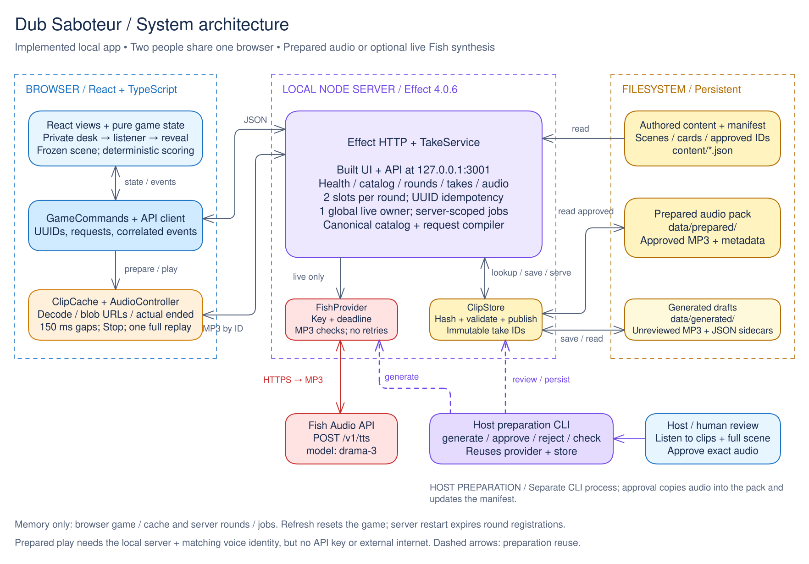

# Dub Saboteur

**Same words. Different delivery. Can you steer their decision?**

A local, two-person voice game built with React, TypeScript, Vite and Effect 4. A director changes the performance of one line; an independent listener hears the scene and chooses what to do. Play with approved, locally stored Fish Audio clips or generate a new performance with Drama 3.

Three prepared scenes are included: **The Cake Invitation**, **The Extremely Normal Exhibition**, and **The Galactic Gala**.

## Game design

- Each scene has three fixed lines. The house protects one; the director targets either remaining line and chooses an available delivery card.
- Two audition slots limit each round. Locking a selected performance changes exactly one line's audio, preserving its words and the other two performances.
- The listener sees neutral context and the unchanged transcript. A complete listen unlocks the two action choices, with one successful full replay allowed.
- The director scores if the chosen action matches their objective; otherwise the house scores. The reveal shows the changed line and original/altered playback. A point records an action match, not proof of a changed mind.

## Run locally

Requires **Node 22 (22.12+) or 24** and npm. Create `.env` from `.env.example` if needed. For the included prepared packs, set:

```dotenv
FISH_VOICE_ID=c70cfb98867a4bfb9ae20d2401257b92
LIVE_GENERATION_ENABLED=false
FISH_API_KEY=
```

```powershell
npm install
npm run build
npm start
```

Open **http://127.0.0.1:3001**. Prepared play needs the local server and matching voice ID, but no API key or external internet. For live auditions, add your authorized `FISH_API_KEY` to the ignored `.env`, set `LIVE_GENERATION_ENABLED=true`, and restart.

For development, `npm run dev` starts Vite at **http://127.0.0.1:5173** and proxies `/api` to port 3001; stop the built server first.

## Play

1. Activate sound, check headphones and enter distinct player names. Choose a scene.
2. Keep the listener away from the private screen and audio. Register the round, choose a target line/card, and audition saved or new audio. New audio requires private listening and acceptance for intact words and audibility.
3. Select a usable audition and **Lock performance & hand over**. A slow or failed live audition can offer its matching saved substitute without another synthesis call.
4. Pass the device and headphones. The listener accepts handoff, plays the complete scene, optionally replays, and chooses an action.
5. View the result, compare the original and altered line, then swap roles with a fresh scene. Use **Stop audio** or void a broken round without points.

## Architecture

[](docs/architecture/system-architecture.svg)

The browser owns game state and scoring. The server enforces audition budgets and idempotency, owns live jobs, and serves immutable audio; credentials stay server-side. Audio files persist across restarts, while browser games and server round registrations are held in memory.

[Editable Excalidraw](docs/architecture/system-architecture.excalidraw) · [PNG](docs/architecture/system-architecture.png) · [Code-to-diagram map](docs/architecture/README.md)

See the [host guide](docs/host-guide.md) for configuration, audio preparation and checks; the [specification](docs/specs/dub-saboteur.md) for contracts; and [verification](docs/verification.md) for evidence. Human listener/venue rehearsals remain outstanding.
