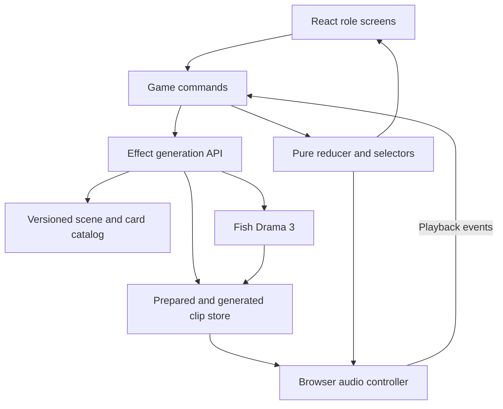
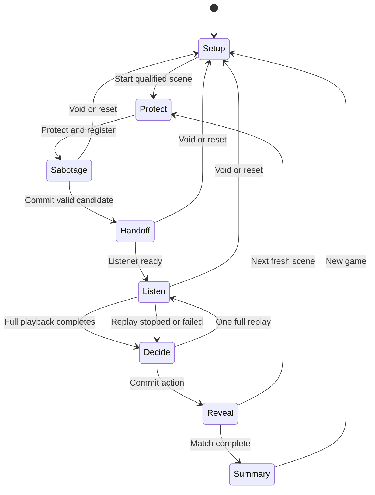
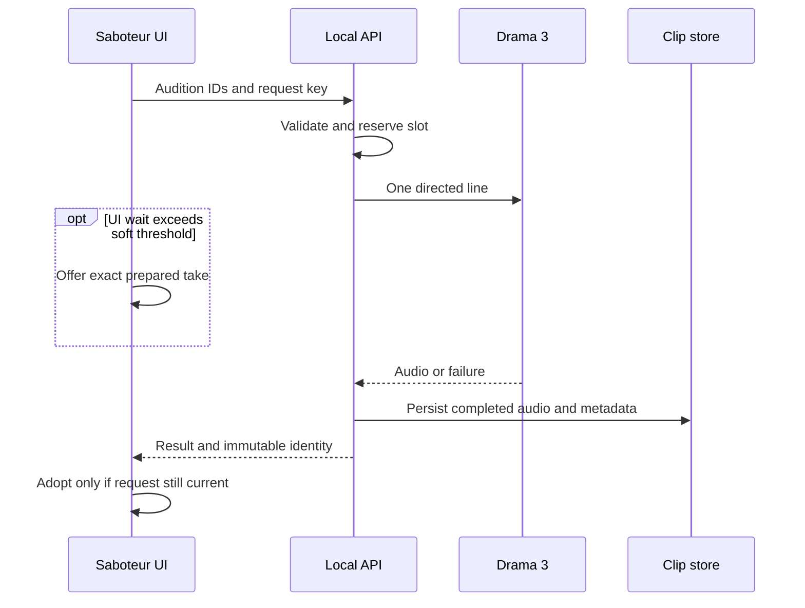

# Dub Saboteur Architecture and Codex Build Handoff

> Superseded by [the implementation specification](docs/specs/dub-saboteur.md). This document preserves review context; use the specification for scope, contracts, acceptance and the next-session prompt.

Version 1.2  
Prepared 24 October 2026  
Target: a working local game and rehearsed demo in approximately 180 minutes  
Primary implementation language: TypeScript

### Review decisions — 24 October 2026

The user confirmed a three-hour build budget, two-person play with private headphone auditions, and a reliable card-based game first. Complete and verify the house round before considering a short custom direction field. A second qualified scene takes priority over that extension. Three-player competition is deferred beyond this build; its rules below are retained as future design, not required implementation.

Submission format and judging criteria remain unspecified. A local laptop demonstration remains the working assumption from this handoff, not a confirmed event requirement. This review does not authorize implementation or paid synthesis by itself.

The guaranteed sixty-second presentation uses approved prepared Drama 3 audio with explicit disclosure. Demonstrate live generation separately when time allows, including private audition before commitment.

## 1 Purpose and implementation mandate

Build Dub Saboteur, a local party game in which the spoken words stay fixed and a player changes the performance of exactly one line to influence a human listener's decision. The user has selected this concept for Fish Audio's Drama 3 launch event. Preserve the playful premise and finish a small, reliable experience before expanding the product.

This was the original implementation handoff and is now historical context. The authoritative specification is `docs/specs/dub-saboteur.md`. The schemas below are design outlines, not an existing application.

The core demonstration is:

1. Three short, authored lines establish a scene.
2. A defender protects one line.
3. A saboteur directs a new performance of another line.
4. A listener, unaware of the private objectives and directions, hears the final scene and chooses an action.
5. Deterministic rules award a point and reveal the original and changed performances.

The pitch is: "Same words. Different delivery. Can you steer their decision?" The blind listener chooses only after hearing the altered scene, so a win establishes that the chosen action matched the saboteur's goal, not that the listener changed their mind from a measured baseline choice. The application does not infer emotions, detect deception, or use a text model to judge audio.

### Success criteria

- A new visitor understands the round from a short example and can participate immediately.
- One complete round works from setup through reveal.
- The final scene replaces exactly one line; the other two use the exact original audio assets.
- Real Drama 3 performances are audible, with live and prepared provenance recorded accurately.
- A failed provider call cannot produce an opponent's win, corrupt a round, or silently substitute an unrelated performance.
- The app runs locally with one startup command and can play an approved prepared round without an internet connection.
- The builder has a rehearsed 60-second demo. A second usable scene is the next priority after the one-scene P0 completion gate.

### Scope priorities

| Priority | Deliverable |
| --- | --- |
| P0 | One excellent scene; two-person house mode; one protected line; four direction cards; two candidate slots; explicit listener handoff; one-line replacement; one full replay; deterministic result and reveal; real speech integration; matching prepared fallback; focused verification. |
| P1 within the same build if time permits | A second usable scene first; then a short custom direction field only after the complete card-based round is verified and rehearsal time remains protected. Custom direction contracts must be specified before implementation. |
| After the event | Three-person competition, additional scene packs, shared challenges, online rooms, user accounts, publishing and richer editing. Complete custom directions here if omitted from the build. |

The first complete P0 round is the delivery gate. A polished lobby without that round is incomplete.

## 2 Frozen game rules

Use the role names **defender**, **saboteur**, and **listener** consistently in code and interface copy.

### Round rules

1. Load one versioned scene with exactly three locked lines, two possible listener actions, an authored defender goal, and three approved baseline clips.
2. The defender sees the baseline and their desired action, then protects exactly one line.
3. The protected line is visible to the saboteur. It cannot be targeted. There is no hidden-shield failure round.
4. The saboteur's goal is the other action. They choose any unprotected line and one of four authored direction cards.
5. The round has two candidate slots. The saboteur may use the second slot for a different eligible line, a different card, or a new take of the same combination.
6. Each slot permanently retains the line, card, voice, scene revision and request that created it. Changing editor controls does not relabel an earlier take.
7. The saboteur selects one usable candidate. Only that candidate's line is replaced in the final scene.
8. Committing the candidate freezes a three-clip playlist. All later generation callbacks are unable to change it.
9. The listener sees neutral context, the unchanged transcript, playback controls and two action labels. They do not see private objectives, the protected line, the changed line, cards, previews or take provenance before voting.
10. The listener completes one full scene playback. They may complete one additional full replay of the same frozen playlist.
11. The listener commits one action. The matching defender or saboteur receives one point. The listener receives no point and is never marked emotionally "correct" or "incorrect."
12. Reveal the winner, objective mapping, changed line, card, provenance and original-versus-altered playback.

### Candidate and provider budgets

Use **two candidate slots per round**, each permitting at most one outbound Fish synthesis call. This is a deliberate bound on both waiting and cost.

- Validating a bad request, rejecting a busy server, replaying audio, or repeating the same idempotency key does not consume another slot.
- Reserve a slot before dispatching its provider call.
- A failed or technically broken take may use an exact matching, human-approved prepared take **inside the same slot**. It does not grant unlimited new provider requests.
- A deliberate second audition uses a new slot and request key, even if its text and direction are identical.
- A prepared-only candidate also occupies one slot. A player cannot preview an unlimited sound bank for free.
- If neither slot can produce a valid candidate and no matching prepared take is available, void the round without awarding points. Infrastructure failure is not a game result.
- Human rejection is for missing words, spoken directions, corruption or inaudibility. A performance that is valid but strategically disappointing is still a take.

This resolves the ambiguity between "two usable takes" and "unlimited technical retries." The UI can say **Two auditions** and explain a failed audition's saved-take replacement without exposing backend terminology.

### Scoring and action order

Actions have semantic IDs such as `accept_cake` and `decline_cake`. Do not name them `defender_action`, `A`, or `B` in the listener interface.

Assign visual button order once per round outside the reducer, then retain it through replay. Authored goal ownership may differ across scenes. A particular button position must not always reveal the defender's objective.

```ts
function winnerFor(scene: Scene, roles: Roles, actionId: ActionId): PlayerId {
  if (!scene.actions.some(action => action.id === actionId)) {
    throw new Error("Invalid action");
  }
  return actionId === scene.defenderGoalActionId
    ? roles.defender
    : roles.saboteur;
}
```

Store one result per round ID and derive the scoreboard from those results. Do not increment score in audio callbacks, request callbacks or React effects. A second answer submission is ignored.

### Play modes

**P0 house mode:** two humans share the laptop. One is the saboteur and one is the listener. The app supplies a deterministic house defender and the prepared baseline. Its protected line is chosen from an authored scene setting, shown before the saboteur acts. After a round, the humans may swap roles for a fresh scene. Display the attacker's result against the house; do not present this as a balanced three-person match.

**Deferred standard mode:** three humans play three rounds with three distinct, qualified scenes. Do not implement its screens, rotation or tests in the initial three-hour build.

| Round | Defender | Saboteur | Listener |
| --- | --- | --- | --- |
| 1 | Player 1 | Player 2 | Player 3 |
| 2 | Player 2 | Player 3 | Player 1 |
| 3 | Player 3 | Player 1 | Player 2 |

A standard match gives each player each role once. Accept shared winners, including a 1–1–1 result. Do not add a tiebreak system.

Do not repeat a scene within the initial standard match: its earlier reveal would disclose the baseline and objectives to a future listener. For this build, offer only house mode. When standard mode is implemented later, require three qualified scenes before enabling it. Repeated-scene casual play can be added later with an explicit familiar-scene label.

A solo builder can implement this app. A meaningful round still requires an independent listener.

## 3 Technology decisions

Use one repository and one package manifest. Avoid a monorepo or separate deployable services.

| Layer | Choice | Reason |
| --- | --- | --- |
| Interface | React and TypeScript with Vite | Small component-based client with a fast development loop. |
| Game rules | Pure TypeScript reducer and selectors | Makes legal transitions, replacement, scoring and stale-result behavior explicit and testable. |
| HTTP server and runtime | Effect v4 HTTP facilities with `@effect/platform-node` | One scoped Node application for content, synthesis and audio files. |
| Boundary validation | Effect Schema | Shared boundary contracts reject malformed IDs and unsupported requests before a paid operation. |
| Voice provider | Direct server-side REST to Fish | Avoid relying on stale SDK model enums or defaults. |
| Playback | A small controller around `HTMLAudioElement` | Sufficient for three short sequential clips and before/after replay. |
| Styling | Plain CSS with a small set of variables | Finish the game without adopting a design framework. |
| Persistence | Authored JSON plus MP3 files and metadata sidecars | Keeps prepared audio and generated takes available without a database. |
| Tests | Vitest for pure rules and a fake provider | Focused checks for actual gameplay and request hazards. |

Use a supported Node LTS version that satisfies the installed Vite toolchain. Pin the resolved dependencies in the lockfile. Reuse an already-working compatible starter if the target repository has one; do not migrate a working project solely to match these library choices.

Vite supplies a React TypeScript template and supports a development proxy. Effect v4 supplies HTTP routing and a Node platform adapter. [S4](https://vite.dev/guide/) [S5](https://vite.dev/config/server-options#server-proxy) [S6](https://effect.website/docs/v4/api/effect/http/HttpRouter)

### Explicit exclusions from the MVP

Do not add an agent framework, text LLM, STT, microphone capture, emotion classifier, WebRTC, WebSockets, cloud queue, Redis, SQL database, ORM, account system, remote multiplayer, payment flow, video generation, lip sync, voice cloning workflow, waveform editor or public deployment.

This game has authored state and one bounded generation operation. An additional reasoning agent has no required job in its initial loop.

### Effect v4 implementation decision

The user selected Effect v4. Registry metadata checked on 24 October 2026 lists `effect@4.0.6` and `@effect/platform-node@4.0.6`; use exact pins and a lockfile when scaffolding. No dependencies have been installed as part of this review. Verify concrete APIs against those installed packages; do not copy v3 or older v4 beta examples. Current v4 HTTP documentation uses `effect/http` imports.

- Keep React, Vite and the pure reducer. Deterministic scoring, signatures and scene compilation remain ordinary functions; they need no service wrapper.
- Use Effect Schema for shared request/response and catalog validation. Use Effect HTTP routing and the Node adapter instead of Hono; no parallel Zod validation layer is needed.
- Use narrowly owned services for Fish I/O, clip storage and the render registry. Compose their Layers once at server startup; reuse the provider and storage Layers in the preparation utility. Load configuration server-side.
- Use typed operational errors and scoped resource cleanup. Map expected errors to the documented HTTP codes; do not turn interruption or defects into successful takes. Never retry paid synthesis automatically.
- The render registry owns synthesis jobs in the server lifetime, not in an individual HTTP request scope. Duplicate callers await the same job. A disconnected caller or prepared substitution must not interrupt that job; provider timeout or server shutdown can end it. The timeout covers response-body consumption as well as headers.
- Preserve atomic reservation and immediate busy rejection. Do not replace the busy policy with an implicitly waiting semaphore queue. Release provider ownership on every terminal path, including failure and interruption, and never release it from a prepared-only operation.
- Keep browser audio resource ownership explicit. There is no requirement to introduce Effect services or a new state library into every React component.
- Vitest remains sufficient for pure tests. Add `@effect/vitest` only if its helpers are useful and its peer requirements match the selected test runner; it is not required merely because the server uses Effect.

Verification must include HTTP-caller cancellation while a shared synthesis job is pending, timeout cleanup, and duplicate callers receiving one result from one provider call.

## 4 Architecture and ownership



### Ownership table

| Component | Owns | Does not own |
| --- | --- | --- |
| Canonical catalog on server | Locked words, voice selection, cards, revisions, goal mapping and manifest references | Human interpretation or score |
| Browser reducer | Match and round phases, roles, protection, candidate selection, frozen playlist, replay completion and committed results | Network requests or media playback |
| Browser command controller | Explicit user commands, request IDs, HTTP calls and callback correlation | Independent scoring rules |
| Server render registry | Immutable render-round binding, slot reservation, local idempotency and provider concurrency | Full multiplayer game authority |
| Fish adapter | Provider authentication, constant model selection, request and response handling | Game policy |
| Clip store | Immutable bytes, metadata, content signatures and exact prepared lookup | Deciding whether the actor sounded convincing |
| Audio controller | One active playback run, ordered clip playback, stopping and actual completion events | Choosing a winner |
| Listener selector | An allowlisted public view model | Protecting against a person inspecting browser memory |

The browser is authoritative for this trusted local game's progression. The server validates provider spending and canonical synthesis inputs. Its small render registry is not a second copy of the game reducer.

### Development and demo runtime

- Development: Vite serves the interface on `127.0.0.1:5173`; the Effect server runs on `127.0.0.1:3001`; proxy `/api` to the Effect server.
- Demo: build the frontend, then let the Effect server serve `dist` and `/api` from one local port. Rehearse this built configuration.
- Use relative API URLs in the client so development and demo share the same client code.
- Bind to loopback by default. Public hosting and room security are later work.
- Keep round state in memory. A page refresh starts a fresh game; a server restart invalidates render-round registries. Prepared files survive. Explicit recovery is preferable to a partial, untested resume mechanism.

A committed round whose frozen clips are already cached may finish after a server restart: it needs no further render operation. An uncommitted round receiving `round_not_found` must restart. Do not silently recreate its registration and replenish its slots.

## 5 State machine and domain contracts



House mode uses the same flow; the protect command is supplied by the authored house setting. Registration failure leaves the round in protect with a retry action. A successful replay returns to decide without changing the frozen scene. Stopping or failing an optional replay also returns to decide, preserving the completed initial listen and leaving the replay allowance unused. Stopping or failing the initial playback stays in listen with voting unavailable.

### Core type outline

```ts
type PlayerId = string;
type ActionId = string;
type LineId = "line_1" | "line_2" | "line_3";
type Phase =
  | "setup" | "protect" | "sabotage" | "handoff"
  | "listen" | "decide" | "reveal" | "summary";

type Roles = {
  defender: PlayerId; // "house" in house mode
  saboteur: PlayerId;
  listener: PlayerId;
};

type Scene = {
  id: string;
  revision: number;
  title: string;
  listenerContext: string;
  voiceId: string;
  actions: readonly [
    { id: ActionId; label: string },
    { id: ActionId; label: string }
  ];
  defenderGoalActionId: ActionId;
  houseProtectedLineId: LineId;
  lines: readonly [SceneLine, SceneLine, SceneLine];
};

type SceneLine = {
  id: LineId;
  text: string;
  baselineDirection: string;
  baselineTakeId: string | null; // null means not ready
};

type Take = {
  id: string;
  sceneId: string;
  sceneRevision: number;
  lineId: LineId;
  directionId: string;
  directionRevision: number;
  voiceId: string;
  requestedModel: "drama-3";
  renderSignature: string;
  audioUrl: string;
  origin: "fish-api" | "test-fixture";
  review: "unreviewed" | "approved" | "rejected";
};

type CandidateSlot = {
  slotId: string;
  index: 1 | 2;
  lineId: LineId;
  directionId: string;
  requestId: string;
  status: "pending" | "ready" | "failed" | "rejected";
  usability: "unchecked" | "accepted" | "rejected";
  take: Take | null;
  selectionSource: "generated-this-round" | "prepared" | null;
};

type RoundState = {
  id: string;
  sceneId: string;
  sceneRevision: number;
  roles: Roles;
  phase: Phase;
  protectedLineId: LineId | null;
  slots: CandidateSlot[]; // maximum two
  activeRequestId: string | null;
  activePlaybackRunId: string | null;
  activePlaybackPurpose: "initial" | "replay" | null;
  selectedSlotId: string | null;
  finalTakeIds: readonly [string, string, string] | null;
  listenerActionOrder: readonly [ActionId, ActionId];
  initialListenComplete: boolean;
  fullReplayComplete: boolean;
  answerActionId: ActionId | null;
  result: RoundResult | null;
};

type RoundResult = {
  roundId: string;
  winnerId: PlayerId;
  actionId: ActionId;
};

type MatchState = {
  mode: "house" | "standard";
  players: Array<{ id: PlayerId; name: string }>;
  sceneOrder: string[];
  roundIndex: number;
  round: RoundState | null;
  resultsByRoundId: Record<string, RoundResult>;
};
```

Runtime validation must enforce tuple lengths, unique line IDs, distinct action IDs, a valid goal, valid protection, and consistent clip metadata. The public content response can omit generation instructions and expose only direction labels; the server remains the canonical compiler.

`CandidateSlot.usability` records acceptance for this round. `Take.review` describes the prepared-bank review status. A player's acceptance must not automatically promote an unreviewed take into the global prepared bank. A reviewed prepared take starts accepted for the slot; the host may still reject an obviously broken playback.

Baseline takes use the reserved `directionId: "baseline"` and `directionRevision: scene.revision`; card IDs must not use that reserved value. A baseline direction change requires a scene revision change. Candidate requests accept only current card IDs.

Adopting a prepared substitute sets the existing slot to `status: "ready"`, `usability: "accepted"`, and `selectionSource: "prepared"`. Preserve its immutable line/card/request identity and retain any original provider failure separately as diagnostic metadata. Track rejected take IDs per round and exclude them from later fallback offers. The manifest designates one default prepared take per exact combination; multiple approved assets must not expose an unlimited audition bank.

### Reducer and command boundary

Keep the reducer pure. Create UUIDs, select shuffled action order and make API calls in command handlers, then dispatch completed values. React's reducer contract requires purity; development Strict Mode can invoke reducers and initializers twice. [S7](https://react.dev/reference/react/useReducer)

Important events include `START_ROUND`, `PROTECT_LINE`, `REGISTERED`, `RESERVE_SLOT`, `RESERVATION_REJECTED`, `TAKE_READY`, `TAKE_FAILED`, `MARK_SLOT_USABLE`, `USE_PREPARED`, `SELECT_SLOT`, `COMMIT_TAKE`, `LISTENER_READY`, `PLAYBACK_STARTED`, `PLAYBACK_COMPLETE`, `PLAYBACK_STOPPED`, `PLAYBACK_FAILED`, `COMMIT_ACTION`, `NEXT_ROUND`, and `VOID_ROUND`.

Every asynchronous completion includes the round ID and its request or playback ID. A completion for an older round or invalidated request is ignored.

### Invariants

1. Exactly three baseline takes are required before a scene can start.
2. Exactly one line is protected.
3. At most two slots can be reserved; neither targets the protected line.
4. A slot's original identity never changes.
5. A fresh generation never occurs inside a reducer or mount effect.
6. Committing copies baseline take IDs and changes exactly one entry, using the chosen slot's original line ID.
7. No pending network result can mutate a committed playlist.
8. A completed listen refers to the current frozen playlist and current playback run.
9. Voting requires a completed initial listen, phase `decide`, no active playback run and a valid scene action.
10. There is at most one result per round.
11. Prepared substitutions match the complete current render specification.
12. Test fixtures cannot qualify a scene as demo-ready or be labeled Drama 3 output.

Only a current listener run with purpose `initial` or `replay` can change listen-completion state. Preview and reveal playback never unlock voting. The one successful replay is available only after the initial listen; after it completes, disable further listener Play/Restart actions. A replay Stop/error returns to decide, so the listener may either answer or try that replay again.

## 6 Interface and local play procedure

Use a compact theatre/studio visual theme: dark background, readable cream text, one accent color, large cards and clear stage-versus-backstage views. Prioritize legibility on a laptop in a crowded room. Keep provider settings, cache keys and transport details out of player-facing copy.

| View | Required controls and content | Exclusions |
| --- | --- | --- |
| Setup | House mode first, names, qualified scene status, sound check, concise rules | Account creation, cloud configuration |
| Defender | Private objective, baseline preview, three shield choices | Listener-visible objectives |
| Saboteur | Opposite goal, protected line, two eligible targets, four cards, slots, private audition, select and commit | Arbitrary text editing, voice switching |
| Handoff | Neutral screen asking the next player to take over, explicit ready button | Autoplay or continued private audio |
| Listener | Neutral context, unchanged transcript, full-scene play/stop, progress, two actions after completed playback | Cards, shields, changed-line styling, take counts, goal ownership, revealing error text |
| Reveal | Winner, objective mapping, changed line and card, prepared/live provenance, original/altered playback, next | Emotion scores or claims of detecting truth |
| Summary | Scores, role history, shared winners, play again | Invented tiebreaks |

Build the listener component from a `selectListenerView(state, catalog)` projection. Render only those fields. Do not put private labels into the DOM and hide them with CSS. Do not make the first action button always correspond to the defender.

This is privacy for trusted pass-the-laptop play, not an anti-cheat boundary against developer tools. During private previews, the listener must look away and not hear the audio. Use headphones or ask the listener to step away. With no private audition available, use an approved prepared take. Do not silently accept an unheard live take. A technically broken public playback voids the round without a point if it cannot be recovered faithfully.

Stop playback on every role handoff. Use keyboard-accessible controls, visible focus, explicit sound activation and volume control. Plain captions assist with the words; they do not reproduce the performance distinction. An assisted or directing role can support participants who cannot hear the relevant cues.

Use a neutral tone or unrelated sample for setup sound check. Do not expose an upcoming scene's baseline to its listener through that control.

## 7 Starter scenes and direction cards

The following scripts and directions are authored starting content. Their intended effects require a human listening check. A direction label is never an audio-quality measurement.

Keep one approved voice identity across all lines and alternatives in a scene. Start with one voice across the whole MVP to simplify preparation. Configure that voice on the server; do not offer voice switching during play. The Drama 3 guide lists public example voices, including Sheila (`f3a2b90078d54a65af4b95f63bc7798e`), but public listing alone is not a substitute for appropriate usage rights. [S1](https://docs.fish.audio/features/text-to-speech/drama-3)

Resolve `FISH_VOICE_ID` into the effective server catalog at startup. In this MVP that one configured value becomes every effective `Scene.voiceId`. The preparation utility, live adapter and manifest validator must use that same resolved catalog. Changing the configured voice makes old incompatible packs unavailable; it never silently relabels them. Prepared-only play still needs the catalog's configured voice identity, but does not need an API key or an internet connection.

### Scene one The Cake Invitation

| Field | Value |
| --- | --- |
| Scene ID and revision | `cake_invitation`, revision `1` |
| Listener context | You are at an excessively formal cake tasting. The host offers you the first slice. Decide whether to accept or politely decline. |
| Action IDs and labels | `accept_cake`: Take the first bite; `decline_cake`: Politely decline |
| Defender goal | `accept_cake` |
| Saboteur goal | `decline_cake` |
| House-protected line | `line_2` |

| Line ID | Locked words |
| --- | --- |
| `line_1` | That is a very special cake. |
| `line_2` | I made it just for you. |
| `line_3` | Go on. Have a bite. |

Baseline direction: **Warm, naturally proud of your baking and genuinely welcoming. Address a guest casually. Keep the words exact and the delivery understated.**

The intended baseline invites acceptance. All three lines should have a plausible alternate delivery: suspiciously misplaced delight, strained reassurance or an invitation delivered with excessive anticipation. If people decline every version because the words already feel ominous, use the exhibition scene for the main demo instead of increasing melodrama.

### Scene two The Galactic Gala

| Field | Value |
| --- | --- |
| Scene ID and revision | `galactic_gala`, revision `1` |
| Listener context | You are booking a host for the Galactic Gala, an absurdly formal awards night. This is an applicant's short audition. Decide whether to book them or keep looking. |
| Action IDs and labels | `book_host`: Book the host; `keep_looking`: Keep looking |
| Defender goal | `keep_looking` |
| Saboteur goal | `book_host` |
| House-protected line | `line_3` |

| Line ID | Locked words |
| --- | --- |
| `line_1` | It's lovely to be here. |
| `line_2` | I have something planned for everyone. |
| `line_3` | This should be a memorable evening. |

Baseline direction: **Formal and slightly distant, with measured pacing and restrained warmth. Make the anticipation mildly difficult to read. Avoid an overt villain voice, a conspicuous whisper, an obvious laugh or added words.**

This is a rescue round: the saboteur tries to make the audition reassuring. Keep the baseline mild enough that one warmer line could plausibly change the listener's impression. Do not create three obviously sinister lines and expect a one-line rescue.

### Scene three The Extremely Normal Exhibition

| Field | Value |
| --- | --- |
| Scene ID and revision | `normal_exhibition`, revision `1` |
| Listener context | You manage a tiny museum. Its team has prepared tonight's new display and sent this announcement. Decide whether to open it to guests or request a rehearsal first. |
| Action IDs and labels | `open_exhibition`: Open to guests; `request_rehearsal`: Request a rehearsal |
| Defender goal | `open_exhibition` |
| Saboteur goal | `request_rehearsal` |
| House-protected line | `line_1` |

| Line ID | Locked words |
| --- | --- |
| `line_1` | We've made a few changes. |
| `line_2` | Everything is in place. |
| `line_3` | We're ready when you are. |

Baseline direction: **A competent museum colleague giving an ordinary update. Natural conversational pacing, restrained warmth, settled and ready. Avoid exaggerated cheerfulness, ominous effects and added words.**

The alternate performance can turn a routine adjustment into a confession, reassurance into over-rehearsed reassurance, or readiness into someone bracing for consequences.

### Four authored cards

Store the direction as plain text without enclosing tags. The server compiler supplies the brackets.

| ID | Private label | Direction text |
| --- | --- | --- |
| `hidden_delight` | Badly hidden delight | Try to sound professionally composed. Let a small trace of inappropriate delight escape near the final important word, then recover. Keep it subtle and keep the words exact. |
| `thin_confidence` | Thin confidence | Begin with ordinary confidence. Let one brief hesitation or caught breath reveal that maintaining it takes effort, then finish as though nothing happened. Keep the words exact and avoid melodrama. |
| `ordinary_tuesday` | An ordinary Tuesday | Give a familiar, routine update as someone who has done this many times. Use grounded, matter-of-fact pacing. Avoid mystery, sarcasm, exaggerated warmth and added words. |
| `quiet_conviction` | Quiet conviction | Use sincere warmth and steady conviction. Address one person naturally and directly. Be reassuring without overselling it. Keep the performance restrained and the words exact. |

Set each card's initial revision to `1`. Show all four labels, but in the rehearsed demo enable only combinations with an exact approved fallback for the chosen line, in both live and prepared modes. Prepared-only mode has the same availability restriction. An optional exploration setting may enable uncovered live combinations with a private "No saved take available" notice. Do not claim that a card guarantees either outcome.

The first extension, after the complete game is working, is a short free-written direction field. It must remain distinct from the spoken words, retain length limits and use human take review. Word-span editing is later work.

Custom directions have no guaranteed exact prepared fallback. If this extension is selected, specify its request validation, immutable direction identity and signature before coding. A failed custom audition may explicitly switch to a saved card using an available audition slot; never relabel saved audio as following the custom direction. This extension must not delay the card-based demo.

## 8 HTTP contracts

Use JSON for application requests and metadata responses, and immutable audio URLs for playback. Do not mix base64 audio into JSON or implement multiple incompatible render protocols.

| Route | Purpose |
| --- | --- |
| `GET /api/health` | Local readiness, whether the key is configured, whether live generation is enabled, and whether the provider slot is busy. Never return secrets. |
| `GET /api/catalog` | Scene DTOs, card labels, qualified baseline take references and approved prepared alternatives. |
| `POST /api/rounds` | Register a render-round policy after protection has been chosen. |
| `POST /api/rounds/:roundId/takes` | Reserve one candidate slot and generate a new take or select one prepared take. |
| `GET /api/audio/:takeId` | Serve an identified completed audio asset with the correct content type. |

### Register a round

The browser creates its UUID when starting a round. Registration binds that identity to a scene revision and protected line. This is a render policy, not another authoritative game state machine.

```json
{
  "roundId": "<uuid>",
  "gameMode": "house",
  "sceneId": "cake_invitation",
  "sceneRevision": 1,
  "protectedLineId": "line_2"
}
```

Validate the UUID, scene revision and line membership. Pin the current direction-card revisions. A repeated identical registration returns the existing binding; a conflicting registration using that UUID returns `409 round_conflict`. Do not reset its spent slots. In house mode, require the scene's authored house protection.

Success returns the round ID, pinned revisions, `maxSlots: 2` and slots remaining. The client may enter sabotage only after this registration succeeds. Prepared-only play still uses the local server and this registry; it does not require provider connectivity.

### Create a candidate

```http
POST /api/rounds/<roundId>/takes
Content-Type: application/json
Idempotency-Key: <new-uuid-for-this-audition>
```

```json
{
  "lineId": "line_1",
  "directionId": "hidden_delight",
  "mode": "live"
}
```

`mode` is either `live` or `prepared`. The endpoint does not accept arbitrary dialogue, voice IDs, provider model, URLs, paths or generation settings. Resolve those from the canonical catalog. A live request always asks for a new performance; only repeating the same idempotency key reuses that operation.

Use the idempotency UUID as `slotId`; the browser knows it before the request finishes. Create a provisional client slot immediately, using the first available local index (1 or 2) and the immutable line/card binding. Do not renumber surviving slots. Echo `slotId` and `slotConsumed` on every response that can identify a valid request. A confirmed pre-reservation rejection removes the provisional slot and restores availability, unless the player has already chosen a prepared substitute for it. Live configuration and prepared availability checks happen before reservation.

If a transport timeout leaves reservation uncertain, retain the provisional slot. A deliberate status retrieval repeats the same request and key; it cannot create another provider call. Do not free an uncertain slot and issue a fresh key automatically. If a prepared substitute has already been selected, keep that locally consumed slot and its chosen take; late metadata can reconcile bookkeeping but cannot replace the selection or invalidate a committed scene. The client may conservatively consume more slots than the server when a prepared substitute resolves an uncertain request, never fewer. The server's slot limit remains a ceiling on provider requests.

Illustrative successful metadata:

```json
{
  "roundId": "<uuid>",
  "requestId": "<idempotency-uuid>",
  "slotId": "<same-idempotency-uuid>",
  "slotIndex": 1,
  "slotConsumed": true,
  "status": "ready",
  "selectionSource": "generated-this-round",
  "take": {
    "id": "<take-uuid>",
    "sceneId": "cake_invitation",
    "sceneRevision": 1,
    "lineId": "line_1",
    "directionId": "hidden_delight",
    "directionRevision": 1,
    "voiceId": "<configured-approved-voice>",
    "requestedModel": "drama-3",
    "renderSignature": "<sha256>",
    "audioUrl": "/api/audio/<take-uuid>",
    "origin": "fish-api",
    "review": "unreviewed"
  }
}
```

New audio starts as unreviewed. The saboteur's private audition can mark it usable for the current round. Promoting a take into the reusable prepared bank is a separate host review action, not an automatic effect of winning a round.

Illustrative failure metadata:

```json
{
  "roundId": "<uuid>",
  "requestId": "<idempotency-uuid>",
  "slotId": "<same-idempotency-uuid>",
  "slotIndex": 1,
  "status": "failed",
  "slotConsumed": true,
  "code": "provider_timeout",
  "preparedTakeId": "<matching-approved-take-id-or-null>",
  "message": "The new take is unavailable. A saved performance may be used."
}
```

The prepared ID is optional and must match the same immutable slot specification. Choosing that fallback updates the existing client slot; it is not another generation request. The canonical catalog's approved alternatives support the same exact lookup while the live request is still pending. The server's job may still finish, but its result cannot override the chosen fallback. The local slot index controls presentation order; a server reservation index is bookkeeping and must not relabel an existing candidate.

### Application error categories

| HTTP status | Stable code | Behavior |
| --- | --- | --- |
| 400 | `invalid_request` | Reject before reservation. |
| 404 | `round_not_found` or `take_not_found` | Explain that the round or asset is unavailable; restart or choose an available scene. |
| 409 | `protected_line`, `round_conflict`, `idempotency_conflict`, `budget_exhausted` | Preserve existing takes and correct the requested action. |
| 409 | `provider_busy` | No slot consumed; permit replay, commitment or a prepared candidate while the existing call finishes. |
| 422 | `prepared_take_missing` | No new prepared slot consumed; choose a supported combination. |
| 503 | `live_unavailable` | Missing key or live disabled; use prepared mode. |
| 502 or 504 | `provider_error` or `provider_timeout` | No automatic provider retry; offer an exact prepared substitute for the reserved slot. |

A provider `429`, authentication failure or balance failure should be mapped to a useful local message and code. Do not pass raw provider bodies or headers to the browser.

### Provider request

Fish documents `POST https://api.fish.audio/v1/tts`, bearer authentication, JSON input and the `model` header. Set that header to `drama-3`; the documentation warns that missing or unrecognized selection can fall back to another model. [S1](https://docs.fish.audio/features/text-to-speech/drama-3) [S2](https://docs.fish.audio/api-reference/endpoint/openapi-v1/text-to-speech)

```http
POST https://api.fish.audio/v1/tts
Authorization: Bearer <server-only-key>
Content-Type: application/json
model: drama-3
```

```json
{
  "text": "[trying to sound composed, with a trace of misplaced delight] That is a very special cake.",
  "reference_id": "<configured-approved-voice>",
  "format": "mp3",
  "latency": "normal"
}
```

The compiler is deliberately small: wrap the authored direction in brackets and append the literal locked line. Keep generation settings constant. Record `requestedModel`, which describes the request actually sent; do not invent independent verification of the served backend model.

The public MVP does not depend on relative revision of prior takes or waveform-preserving inpainting. The launch material places those editing tools in invite-only testing. [S3](https://fish.audio/blog/fish-audio-drama-3/)

## 9 Generation lifecycle and reliability



The store write occurs only for successful audio. Failures produce a terminal job result and may refer to an existing prepared take.

### Local idempotency

Keep an in-memory job map keyed by the request UUID. Each entry stores its round ID, immutable input fingerprint, shared promise and terminal response.

Order the work as follows:

1. Check for an existing request key. Identical inputs await or return that original job; conflicting inputs return a conflict.
2. Validate the registered round, revisions, line, card, protection and mode. Check live configuration or exact prepared availability before reserving anything.
3. Check slot capacity and, for live mode, the global provider-busy flag.
4. Reserve the slot and register the job synchronously **before the first await**. A live job also acquires the provider lock, recording its request ID as the owner.
5. Make at most one Fish call for this live slot.
6. Persist successful bytes and finalize the response.
7. A live job releases its own provider lock in `finally`. Prepared jobs never acquire or release that lock.

Only one provider call is active in the local MVP. There is no durable queue. A busy rejection consumes no slot. The client also uses an immediate command-level in-flight guard so double clicks cannot launch two distinct paid requests before React state updates. Keep that guard specific to new live requests; it must permit prepared selection and commitment while a detached live request finishes.

Local idempotency is limited to the running process. It does not promise exactly-once provider billing across a server crash. Do not assume the provider honors an idempotency header merely because this app does.

### New take identity versus replay caching

| User intent | Correct behavior |
| --- | --- |
| Replay a take | Serve the same immutable clip; no synthesis. |
| Retrieve the result of the same request | Reuse its request key; no second provider call. |
| Generate the second audition | New key and slot; make a fresh call even for identical directions. |
| Use a prepared take | Explicitly select an approved matching clip; preserve prepared provenance. |

A content signature groups compatible performances; it must not collapse a deliberate reroll into the same audio. Hash the complete compiled provider input: bracketed direction plus literal spoken line, effective voice, requested model, format, latency and any other fixed generation settings. Also retain scene, line and card identities and revisions. Prepared lookup must agree on both identity and signature.

### Initial timeout choices

These are application defaults to tune after the venue smoke test, not provider performance claims:

- 8 seconds: show a private "Still rehearsing" message and offer an exact prepared alternative.
- 20 seconds: provider request deadline, including body consumption.
- 25 seconds: browser request deadline.
- No automatic outbound provider retries in the MVP.

Do not abort the server job just because the UI selected a fallback or navigated away. Let it finish or hit its deadline; this avoids a shared-consumer cancellation design. A timeout does not prove that upstream processing or billing stopped.

While a detached call is still active, block another live call but permit prepared play and commitment. Its eventual completion may clear provider-busy status and persist an asset without changing the current game.

### Stale completion checks

Adopt a generation response only if all of these hold:

- Response round ID matches the current round.
- Response request ID matches the active request for the corresponding slot.
- The slot has not already adopted a prepared substitute.
- The round remains in sabotage and is not committed or voided.

When committing, stop preview audio, invalidate request adoption, copy the exact three final take IDs and enter handoff. Late results may remain in the local store, but cannot become a new candidate or start audio.

### Clip storage

Use opaque validated take IDs, not client-supplied file paths. Keep audio bytes immutable.

For successful responses:

1. Check HTTP success and reject explicit JSON or HTML error responses.
2. Read within the deadline and a conservative 2 MiB per-line cap.
3. Reject empty output. Check plausible MP3 bytes and let browser playback expose decoding failures. A file check is not an acting-quality check.
4. Write a temporary file, then rename it to the final asset path.
5. Write a metadata sidecar containing the request specification, identity, source, timestamp and SHA-256 of the audio.
6. Publish the take ID only when both completed assets are present.

The cap is a local guardrail for short lines, not a claimed API limit. Ignore incomplete temporary files and orphaned assets at startup. Never overwrite a baseline when generating an alternative.

Store prepared audio separately from generated audio. Only reviewed prepared entries are used for automatic lookup. Missing or incompatible fallback metadata is a genuine missing fallback, not permission to substitute another funny clip.

## 10 Audio playback design

Use one controller that owns all preview, scene and reveal playback. It may create fresh media elements per clip while ensuring only one is active. Fresh element identities and a playback-run token prevent an event from an old element advancing a new scene.

Suggested controller surface:

```ts
interface AudioController {
  prepare(input: {
    roundId: string;
    takeIds: readonly string[];
  }): Promise<void>;
  playSequence(input: {
    roundId: string;
    runId: string;
    takeIds: readonly string[];
    purpose: "preview" | "initial" | "replay" | "comparison";
  }): Promise<"completed" | "cancelled">;
  stop(): void;
  dispose(): void;
}
```

### Sequence behavior

1. Fetch all required short clips before enabling listener playback. A small blob-URL cache keyed by immutable take ID keeps the listener sequence independent of a new network fetch between lines. Correlate preparation with the captured round ID and exact frozen tuple. A stale preparation may fill the cache, but must not mark a different round ready. On preparation failure, show a neutral retry or void action instead of a permanently disabled screen.
2. Start only after an explicit Play scene click.
3. Await each media element's `play()` promise. It can reject; do not mark playback as started on a button click alone. [S8](https://developer.mozilla.org/en-US/docs/Web/API/HTMLMediaElement/play)
4. Advance using the actual clip completion event with `loop` disabled. Introduce a fixed, short 150 ms inter-line gap as an intentional scene beat. [S9](https://developer.mozilla.org/en-US/docs/Web/API/HTMLMediaElement/ended_event)
5. Every timer and callback checks run ID, round ID and expected clip index. Stop invalidates the run, clears callbacks and pending gap timers, and resolves its active sequence promise as `cancelled`. It must not leave an `ended` promise pending forever. A media failure rejects with a normalized error; cancellation is a separate result.
6. Emit listener `PLAYBACK_COMPLETE` only after all three clips have completed under the same active run and its `initial` or `replay` purpose. Cancelled, failed, preview and comparison runs cannot emit a qualifying listener completion.
7. Revoke object URLs only after they are no longer needed for playback, reveal or replay. Dispose the small cache when starting a fresh session or unmounting the app.

Pause/resume, seeking, waveform rendering and sample-accurate joins are unnecessary for the MVP. Provide Play, Stop, Restart and a global volume control. A stopped or failed sequence does not count as a completed listen. A failed replay can restart without consuming the one successful replay allowance.

If a later clip is blocked by browser playback policy, request a user click to continue or restart; retain the immutable playlist. Do not unlock voting prematurely. A manual playback error must show a neutral listener-facing message while keeping technical information backstage.

No audio is generated during listener playback. The final playlist is:

```ts
const finalTakeIds = scene.lines.map(line =>
  line.id === selectedSlot.lineId
    ? selectedSlot.take!.id
    : line.baselineTakeId!
) as [string, string, string];
```

Use the chosen slot's original line, not the editor's currently selected line. Tests must exercise selecting the first candidate after the second candidate targeted a different line.

## 11 Preparing an honest audio bank

Prepared audio is part of the MVP, not an optional last-minute backup. It makes baseline delivery consistent and lets the game continue when the venue connection is poor.

### Minimum preparation per qualified scene

- Three reviewed baseline clips, one per line.
- For house mode, at least one reviewed alternate for each of the two unprotected lines, using a current card and the same voice.
- Exact metadata for the line, card, revisions and render signature.

The house minimum is five approved clips per scene. All four cards on both eligible house lines require eight alternatives plus three baselines: eleven approved clips. Enable only covered combinations for the rehearsed demo. A call limit bounds attempts, not approved output; allow a bounded preparation budget for rejected takes rather than assuming every call succeeds.

Deferred standard mode requires at least one alternate for every line, yielding six approved clips per scene and eighteen for three scenes. Full four-card coverage on all three lines would require fifteen clips per scene. For the cake and exhibition, prioritize destabilizing alternatives; for the gala, prioritize reassuring ones. Qualify assembled three-line scenes as well as individual clips, and compare a clearly contrasting take with the subtle cards in the actual room.

### Preparation utility

Implement a small `scripts/prepare-audio.ts` utility that reuses the production Fish adapter and clip store. It should:

1. Generate a chosen scene's baseline and specified fallback combinations with an explicit call limit.
2. Write each result as unreviewed and print its take ID and local listening location.
3. Accept an explicit approve or reject action after the host listens.
4. Produce or update `content/prepared-manifest.json` without inventing approval.
5. Check that a scene meets the minimum playable requirements.

Use a single provider call at a time for the first script version. Audition a few representative lines before preparing every combination. Do not assume a large batch will follow the directions well.

### Human review checklist

The reviewer checks that the spoken words are intact, the voice is consistent, the file is audible, no direction was read aloud, and the alternate meaning is perceptibly different. The baseline should plausibly support its authored goal. An approved take is usable content, not proof that every listener will interpret it the same way.

Technical validation of bytes alone cannot mark a take approved. A coding agent may validate file structure and playback behavior; it must not claim human listening results that did not occur.

Keep synthetic-audio disclosure in the game instructions. Show **New take** or **Saved take** in private authoring and reveal views. Keep the blind listener view neutral. Be explicit in the live presentation if a prepared performance is being demonstrated.

## 12 Secrets and operating limits

Store `FISH_API_KEY` in the server environment. Do not prefix it with `VITE_`: Vite exposes variables using that prefix in client code. Do not return it in health responses, logs, source maps or an example file. [S10](https://vite.dev/guide/env-and-mode)

Suggested environment contract:

```dotenv
# Example file only. The real file is ignored by git.
FISH_API_KEY=
FISH_VOICE_ID=
PORT=3001
HOST=127.0.0.1
LIVE_GENERATION_ENABLED=true
PROVIDER_TIMEOUT_MS=20000
```

Keep the model constant in the provider adapter. Resolve the approved configured voice once into the effective catalog as specified in section 7; the provider adapter must not independently override it. A missing voice configuration should produce a setup message, not an arbitrary community-voice choice.

Other small safeguards are directly useful to the demo:

- Apply a small request-body limit and strict JSON schemas.
- Allow only canonical scene and card IDs and the registered scene revision.
- Resolve files from validated take IDs in known directories, never request-supplied paths.
- Keep the development proxy and API on the expected local origins. Do not enable permissive CORS or disable host checks to fix a setup issue.
- Use no participant microphone recordings, face uploads, real-person imitation or private personal stories in the initial content.
- Show a global stop control and keep audio at a reasonable initial volume.
- Avoid repeating provider requests automatically after network errors.

Log only operational metadata needed to diagnose the demo: request ID, round ID, scene/line/card IDs, requested model, elapsed milliseconds, output bytes, result code, source and duplicate-request status. Do not log authorization headers.

The runtime does not require a metrics service. The host needs to know whether synthesis is slow, playback failed, a prepared take was used, or a duplicate was suppressed.

The hosted-service terms and any event credit conditions govern actual usage. Use approved stock or consenting voices. Verify commercial permissions before expanding beyond the event; the self-hosted model license is a separate concern and is outside this build. [S11](https://fish.audio/terms/)

## 13 Repository layout and runnable commands

The paths below are the target layout for a new project, not files already supplied with this handoff. Preserve equivalent existing structure when it is already working.

| Path | Responsibility |
| --- | --- |
| `package.json` | One set of application, preparation and verification commands. |
| `vite.config.ts` | React integration, local proxy and deterministic ports. |
| `src/App.tsx` | Top-level mode, phase routing and context wiring. |
| `src/game/types.ts` | Domain state and event types. |
| `src/game/reducer.ts` | Pure transitions and invariants. |
| `src/game/selectors.ts` | Listener projection, scores, valid targets, availability and button state. |
| `src/game/commands.ts` | Explicit user commands, request IDs and async dispatch. |
| `src/components/` | Setup, protection, direction cards, take cards, handoff, listener, reveal and summary views. Keep components small. |
| `src/audio/AudioController.ts` | Sequence playback and run-token checks. |
| `src/audio/ClipCache.ts` | Completed audio blobs and URL lifecycle. |
| `src/api/client.ts` | Typed local API client and normalized errors. |
| `src/styles.css` | Theme, layout, readable controls and responsive behavior. |
| `shared/contracts.ts` | Request and DTO schemas shared by client and server. No secrets or filesystem imports. |
| `server/index.ts` | Effect runtime startup, routes and built-asset serving. |
| `server/catalog.ts` | Load and validate authored scenes, cards and approved manifest. |
| `server/TakeService.ts` | Round policy, slots, job map, signatures and prepared lookup. |
| `server/FishProvider.ts` | The only module that calls the external speech endpoint. |
| `server/ClipStore.ts` | Immutable audio, sidecars and safe asset serving. |
| `content/scenes.json` | Three versioned scene definitions. |
| `content/directions.json` | Four versioned authored cards. |
| `content/prepared-manifest.json` | Reviewed clip references and exact bindings. |
| `data/prepared/` | Approved prepared audio and sidecars. |
| `data/generated/` | Completed new takes and sidecars. |
| `data/tmp/` | Incomplete writes. Never served as playable audio. |
| `scripts/prepare-audio.ts` | Generate, approve/reject and check prepared content. |
| `tests/` | Focused rule, request and audio-controller tests. |
| `.env.example` | Empty credential placeholders and documented defaults. |
| `.gitignore` | Real environment files, transient generated audio, temporary files and build outputs. |
| `README.md` | Startup, key configuration, local play procedure, fallback setup and known limitations. |

The prepared pack must travel with the demo directory. Do not depend on an untracked file in an unrelated temporary directory. Decide deliberately whether approved audio belongs in the repository or an accompanying local demo pack, according to its permitted distribution and repository conventions. Generated drafts and credentials stay out of commits.

### Required command interface

Implement these commands or document equivalent repository commands clearly:

```bash
npm install
npm run dev
npm run typecheck
npm test
npm run build
npm start
```

- `dev`: start Vite and the local API together; exit clearly on a port collision.
- `typecheck`: check both client and server TypeScript.
- `test`: run the focused suite once.
- `build`: build the client and compile or bundle the server with a consistent module configuration.
- `start`: serve the built frontend and API from one local port, with the real server environment loaded.

Use one package manager and commit its lockfile. A simple development process runner and `tsx` are acceptable; no task orchestration framework is needed.

The audio utility should expose a bounded interface such as:

```bash
npm run audio -- generate --scene cake_invitation --max-calls 6
npm run audio -- approve --take <take-id>
npm run audio -- reject --take <take-id>
npm run audio -- check
```

These are commands Codex must implement, not assertions that a current project already supports them. `generate` counts every outbound call against its limit. Approval is an explicit host decision after listening.

## 14 Verification and acceptance

The application has a few high-value correctness risks. Test those rather than writing snapshots for every screen or checking private implementation details.

### Focused automated checks

| Risk | Required assertion |
| --- | --- |
| Illegal edit | A protected line, unknown card or incompatible scene revision cannot reach the provider. |
| Incorrect final scene | Committing a candidate changes exactly its original unprotected line. Both other take IDs remain identical. |
| Candidate identity drift | Generate slot one for line one, slot two for line three, then choose slot one. The final replacement remains line one with slot one's original card. |
| Duplicate spending | Two concurrent requests with the same idempotency key produce one reserved slot and one provider call. The same key with a different input conflicts. |
| Wrong reroll behavior | A deliberate new request key produces a new provider call and does not merely retrieve a signature-matching old take. |
| Budget and concurrency | Third slots and busy live requests are rejected correctly. A busy pre-reservation rejection consumes no slot. A prepared substitute remains in its original slot. Completing a prepared request during a pending live call must not release that live call's lock. |
| Reservation uncertainty | A confirmed non-consuming rejection frees an unused provisional slot; a transport timeout retains it and reuses the same key. An already selected prepared substitute cannot be erased by a late rejection. |
| Stale completion | A result after fallback selection, commitment, reset or a new round cannot mutate candidates, the frozen scene or playback. Old clip-preparation completion cannot mark the new round ready. |
| Duplicate score | Double-submitting an action records one result and one point, with no point for the listener. |
| False audio completion | A rejected `play()`, mid-sequence error, stopped initial sequence or old completion event does not unlock voting. Stop settles its sequence promise. A stopped replay returns to decide; only a successful replay consumes its allowance. Actions cannot commit during playback. |
| Blind UI leakage | The listener projection and rendered view contain no goal mapping, shield marker, changed-line highlight, card, preview controls or provenance. |
| Prepared mismatch | Lookup cannot cross a scene/card revision, voice, line or render signature. |
| Standard mode, deferred | When implemented after this build, three rotations cover each role once, require three fresh scenes, and allow shared winners. |

Use a fake provider with controllable resolution and rejection for race cases. A synthetic test WAV or fixture can validate sequencing in tests, but it must remain labeled test content and cannot pass demo-readiness checks.

One short browser test for the complete prepared round is useful if a browser-test runner is already available. Otherwise execute the same flow manually. Do not spend the build window establishing broad browser or device coverage.

### Manual acceptance run

1. Start the built app, not only the development server.
2. Run sound check and a prepared house round.
3. Confirm the chosen scene's authored house-protected line and its two eligible target lines.
4. Create one take for each eligible line; commit the first candidate.
5. Confirm the listener receives the first candidate's replacement and the exact two untouched baseline clips.
6. Confirm the listener cannot see private information and must finish playback before voting.
7. Complete a replay; confirm the exact same take IDs are used.
8. Double-click an action; confirm a single result.
9. Inspect the reveal and listen to the original and altered line.
10. Simulate slow generation and choose a prepared take; let the old response finish. Confirm it cannot take over playback or selection.
11. Disable live mode or disconnect the internet while leaving the local server running; complete a prepared round.
12. Restart the server before commitment; the next render operation must report the expired round and offer restart without silently renewing its budget. Separately confirm that a committed round with all clips cached can finish faithfully. Prepared files remain available.

A real-provider smoke test checks that a short directed request returns playable audio. Acting quality, unchanged spoken words and fun require actual listening. Neither HTTP success nor a requested direction is sufficient evidence.

## 15 Implementation sequence and time budget

The times are planning targets for a solo builder, not estimates of guaranteed provider performance. The first 15 minutes test the highest-risk assumption; the final 25 minutes protect the demo.

| Minutes | Build milestone | Exit condition |
| --- | --- | --- |
| 0–15 | Inspect repository and toolchain; configure a permitted voice; generate a baseline and contrasting take; run the short listening test. | An audible contrast exists, or the exact access/content limitation is known. Adjust the card or voice before multiplying content. |
| 15–35 | Scaffold one project, connect the Effect server to Fish and the browser, save real audio, establish the prepared manifest shape. | One real take plays in the browser; credentials stay server-side. |
| 35–60 | Build a complete house-mode vertical slice using one scene and prepared audio. | Protect, alter, hand off, listen, choose and reveal all work. |
| 60–85 | Formalize reducer, two slots, immutable identities, scoring and candidate commitment; connect live generation. | Changing controls cannot corrupt earlier takes; reroll really generates another take. |
| 85–110 | Add private preview, neutral listener view, full-scene replay, reliable sequencing and explicit prepared alternatives. | A late result and a failed playback cannot corrupt the round. |
| 110–135 | Qualify the second scene if P0 is solid. Consider custom directions only if the core verification is already complete and rehearsal time is protected. | One excellent prepared demo remains the gate. A second scene is the next priority; standard mode stays deferred. |
| 135–155 | Run focused rule/request tests and the manual acceptance path; fix material failures. | Replacement, scoring, request identity, blind handoff and fallback are verified. |
| 155–180 | Build the demo configuration, test room audio, rehearse twice, prepare fallback and stop adding features. | A repeatable one-minute demonstration works. |

### The first 15 minutes in detail

Use one scene and two or three neighboring participants. Show only neutral context and action labels to the listener. Compare a baseline and an altered take in different orders. Then let someone direct a change for another listener.

Continue with the current content when people can identify an audible difference and someone voluntarily wants another round or another directing choice. If only the script gets a laugh, revise the line or direction. If the cake wording dominates every decision, switch to the neutral exhibition scene. The approved project remains Dub Saboteur; do not silently substitute another game concept.

If live credentials are missing, build the pure rules, UI, fake-provider tests and preparation utility while leaving live capability visibly unavailable. Existing genuine approved takes may support a prepared demo. If no genuine audio exists, do not claim the finished game is playable: complete the unblocked implementation and report the exact audio/access dependency.

### Scope cuts in order

1. Decorative animation, waveform display and theme variations.
2. Free-written directions and word-span editing.
3. Full four-card fallback coverage on every line.
4. Three-person mode remains deferred regardless of scene count.
5. A third scene and then optional match summaries.

Do not cut the complete house round, frozen playlist, human listener action, original/altered reveal, key isolation, explicit prepared provenance or stale-result protection. Those define the product and its reliable demo.

## 16 Demo runbook

### Before presenting

- Run the built app and local server.
- Use the best tested scene, not a random selection.
- Keep its three baselines and at least one exact alternate already local.
- Check speaker volume where the demo will happen.
- Arrange private audition through headphones or have the listener step away.
- Confirm that reset works and no other audio is playing.
- Make the reveal comparison one click away.

### Sixty-second sequence

| Time | Action |
| --- | --- |
| 0–8 seconds | Say: "You can change the delivery of one line to change another person's decision. The words stay fixed." |
| 8–15 seconds | Show the scene and assign the listener's two actions without exposing objectives. |
| 15–25 seconds | Privately select an eligible line and covered acting card with an approved saved take. |
| 25–40 seconds | Disclose that this is a prepared Drama 3 performance and play the final scene. |
| 40–50 seconds | The listener commits an action. Reveal the winning goal and the changed line. |
| 50–60 seconds | Play the short before/after comparison and invite the next player to rescue an ominous performance. |

If live audio is slow, use a prepared take with accurate disclosure. Do not spend the entire presentation watching a spinner. If a take is broken, void the round and replay a known-good prepared scene rather than treating the failure as sabotage.

The live demonstration is a separate, time-permitting interaction. Budget for generation, headphone audition, handoff and playback; a twenty-second request deadline alone does not fit inside the fifteen-second presentation playback window. Rehearse headphone routing and keep private controls off any audience-facing display.

## 17 Risks and extension boundaries

| Risk | Design response |
| --- | --- |
| A creepy laugh always wins | Include the reassuring gala rescue round, restrained cards and different authored objectives. |
| Only one line matters | Audition alternatives for each line before qualifying a scene; use a visible shield. |
| Two neutral lines overpower one replacement | Use short scenes and moderately directed baselines; test the complete assembled scene. |
| Separate clips sound disconnected | Keep a stable voice and settings, use intentional gaps, and choose self-contained sentences. |
| A future listener recognizes the scene | Use fresh scenes in standard matches; keep repeated scenes in clearly familiar casual play. |
| A new take unexpectedly changes words | Human rejection and an exact prepared substitute; no fabricated transcript verification. |
| A cache makes rerolls identical | Separate request identity from compatibility signatures. |
| Network or audio callbacks arrive late | Immutable committed playlist and request/playback token checks. |
| Public hosting exposes spending or private roles | Keep the MVP local; add authentication, server-authoritative rooms and quotas before remote play. |

### After the event

The first useful extension is player-written acting directions with bounded length and a human usable-take check. Next come more qualified scene packs and shareable challenges.

For actual online multiplayer, move authoritative match state and role-filtered responses to the server; add room membership, reconnect behavior, spending limits and storage appropriate to the hosting environment. The trusted local listener projection is not sufficient for competitive online secrecy. Keep the pure reducer and immutable take identities so these changes do not require redesigning the game rules.

An LLM may later propose scenes and directions behind a schema, followed by human content and audio review. It should not become the authority for score or an unvalidated judge of how the synthesized audio sounded.

## 18 Completion report expected from Codex

At the end of implementation, report:

1. The startup command and local URL.
2. Which modes and scenes are actually playable.
3. Whether the app used live Drama 3, prepared genuine audio, or test fixtures during verification.
4. Which invariant tests and manual smoke checks passed.
5. Any unmet dependency, such as missing credentials, voice permissions or human audio approval.
6. Which scope cuts were made and why.

Include concise README instructions. Do not call the app complete because compilation passes while the audio path or full round remains unavailable. Do not add new infrastructure after sufficient verification; finish the usable demo.

## 19 Official references

Availability and platform facts were checked against the following primary documentation on 24 October 2026. Recheck the narrow provider contract if implementation occurs later; do not expand the task into another broad product-research project.

| Ref | Source | Relevant fact |
| --- | --- | --- |
| S1 | [Fish Drama 3 guide](https://docs.fish.audio/features/text-to-speech/drama-3) | Directing syntax, public example voices and explicit model selection. |
| S2 | [Fish Text to Speech API](https://docs.fish.audio/api-reference/endpoint/openapi-v1/text-to-speech) | Endpoint, authentication, request fields and audio formats. |
| S3 | [Drama 3 launch announcement](https://fish.audio/blog/fish-audio-drama-3/) | Hosted release and limited-access editing distinction. |
| S4 | [Vite getting started](https://vite.dev/guide/) | React TypeScript starter and toolchain requirements. |
| S5 | [Vite server options](https://vite.dev/config/server-options#server-proxy) | Development proxy and local server configuration. |
| S6 | [Effect v4 HTTP router](https://effect.website/docs/v4/api/effect/http/HttpRouter) | Effect HTTP routing; use the matching Node platform adapter. |
| S7 | [React useReducer](https://react.dev/reference/react/useReducer) | Pure reducer contract and Strict Mode behavior. |
| S8 | [HTMLMediaElement play](https://developer.mozilla.org/en-US/docs/Web/API/HTMLMediaElement/play) | Playback promise and rejection handling. |
| S9 | [HTMLMediaElement ended](https://developer.mozilla.org/en-US/docs/Web/API/HTMLMediaElement/ended_event) | Actual completion events and looping behavior. |
| S10 | [Vite environment variables](https://vite.dev/guide/env-and-mode) | Client exposure of variables prefixed with VITE. |
| S11 | [Fish hosted-service terms](https://fish.audio/terms/) | Service-use and content-rights conditions. |

## 20 Prompt to start the Codex implementation

Use the [next-session prompt in the authoritative specification](docs/specs/dub-saboteur.md#12-sources-and-next-session-prompt). The former prompt is retired to avoid competing implementation instructions.
